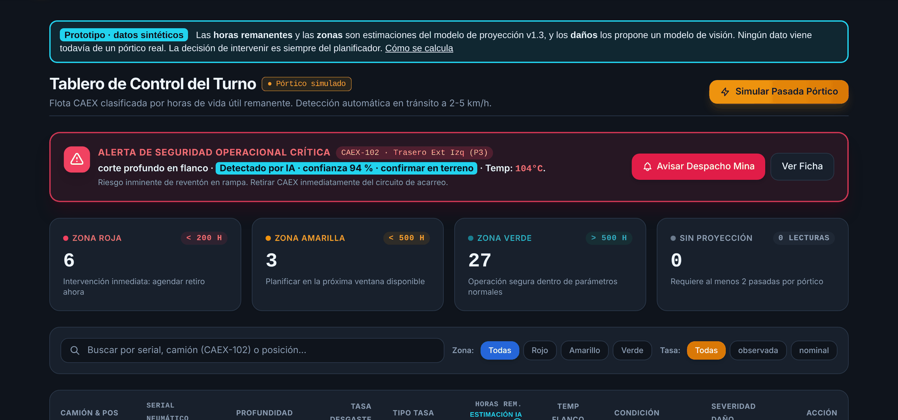
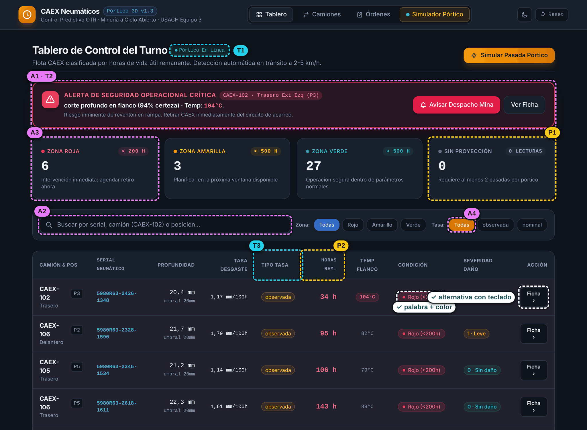
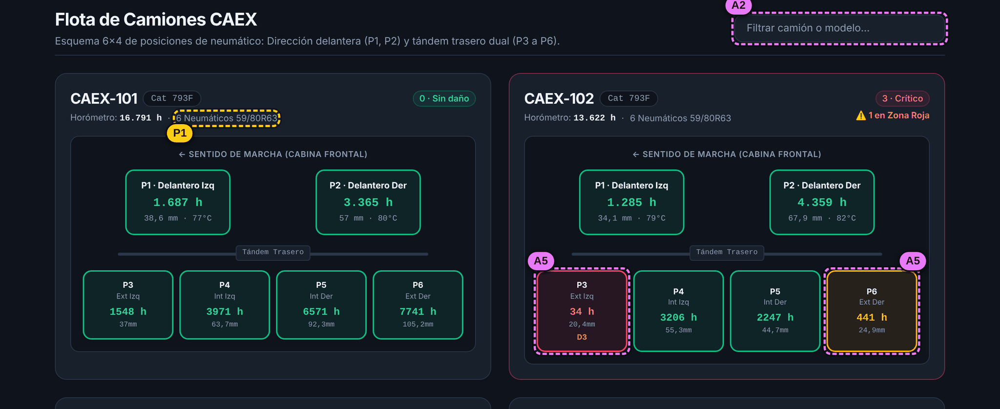
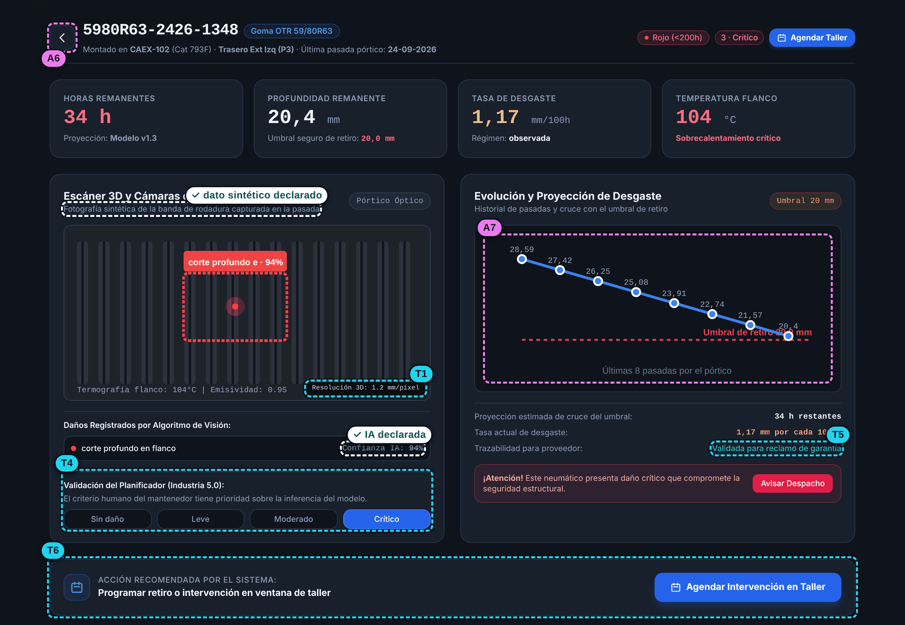
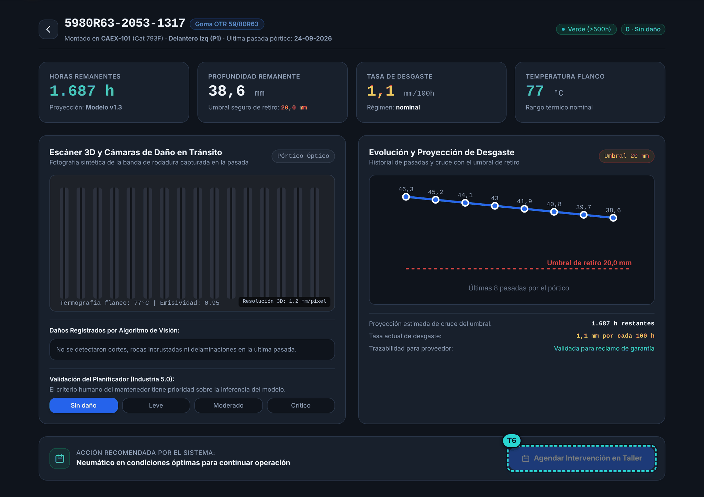
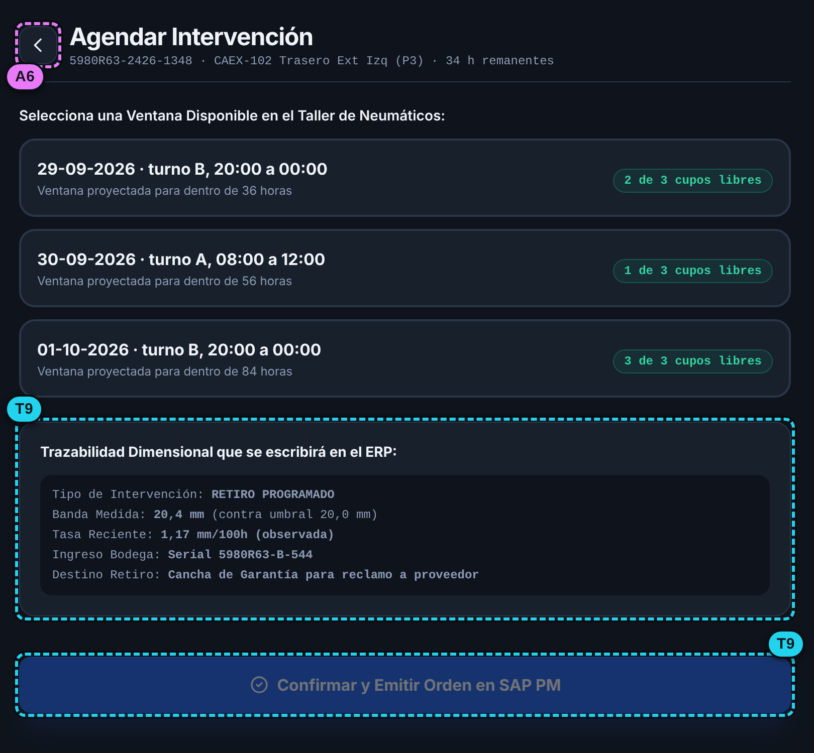
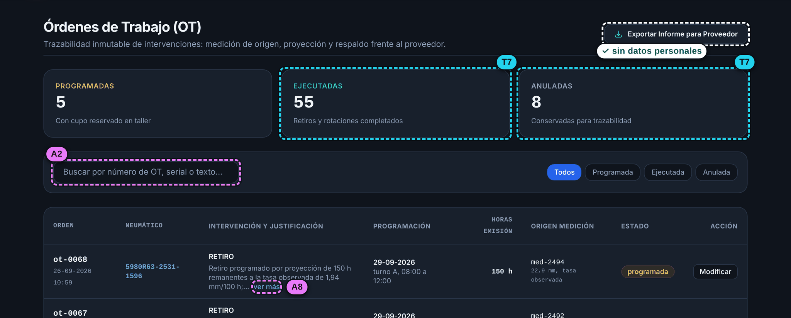
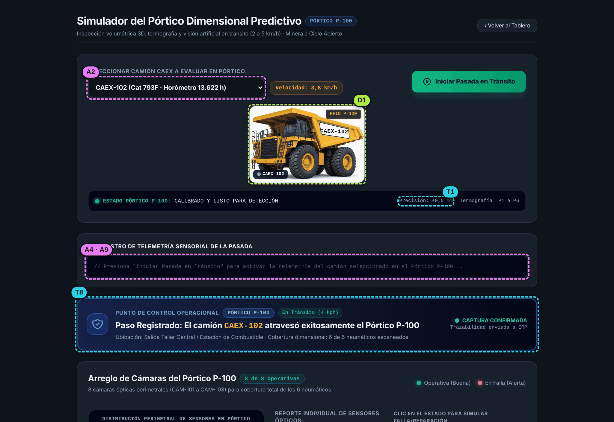
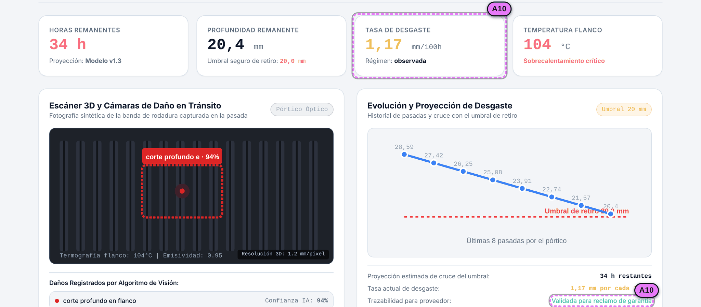
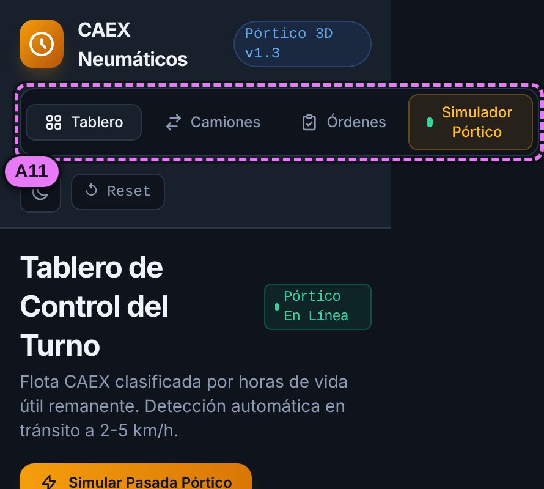

# Análisis ético, de sostenibilidad e impacto preliminar

**Pórtico dimensional predictivo de neumáticos CAEX** · Ingeniería Digital en Acción: Datos, IA y MVPs · USACH · Equipo 3

Francisco Opazo · Héctor Medina · Manuel Ávalos Castillo · Nicolás Echeverría

| Versión | Fecha | Qué cambió |
|---|---|---|
| 1.0 | 14-10-2026 · Semana 6 | Primera versión: mapa de impacto, ficha de datos personales, revisión de sesgo, accesibilidad y transparencia, sostenibilidad y matriz de riesgos |
| 1.1 | 14-10-2026 · Semana 6 | La ficha cubre los 172 campos de la estructura (finalidad, quién lo ve y conservación, campo por campo en el diccionario). El README enlaza este documento |

---

## En una página

Hasta ahora nos preguntamos si el sistema se entiende y si funciona. Esta revisión responde la tercera pregunta: **¿a quién deja fuera?**

Lo más importante que encontramos:

1. **El sistema cambia el trabajo de ocho actores, no solo el del planificador.** El que más cambia es el inspector de neumáticos: deja de medir camión por camión y pasa a verificar lo que el sistema marca. Si no se le asigna tiempo para seguir inspeccionando, pierde la práctica justo cuando el pórtico falle. Lo enunciamos como cambio de trabajo, no como reducción de personas.
2. **La lista del tablero escondía lo que no medía.** Un neumático sin datos, con el serial ilegible o con la lectura arruinada por el barro quedaba al final, como si estuviera sano. Corregimos la regla: ahora sube justo después de los rojos, con el motivo a la vista. La corrección ya está escrita y probada en la base de datos.
3. **El prototipo afirma cosas que todavía no son ciertas.** Dice «Pórtico en línea», «calibrado a ±0,5 mm» y «validada para reclamo de garantía», y algunos contadores suman números fijos. Con datos sintéticos, eso puede engañar en una demo o frente a un proveedor. Proponemos un aviso de prototipo y un aviso de IA en cada dato estimado.
4. **El sistema maneja pocos datos personales, pero hay uno delicado.** Una pasada por el pórtico (camión, hora, velocidad), cruzada con el rol de turnos, identifica al conductor. Decidimos no guardar quién conducía y dejar escrito que el sistema no se usa para evaluar ni sancionar a operadores.
5. **La accesibilidad tiene doce puntos por corregir según WCAG 2.2.** Los más serios son el tema claro, donde los colores de estado casi no se leen; un aviso que parpadea sin pausa; y gráficos que un lector de pantalla no puede describir.

El análisis es preliminar: se hizo con datos sintéticos, sin usuarios reales y sin asesoría legal. Lo que depende de eso queda marcado como **a validar**.

**Contenido:** [1. Mapa de impacto y exclusión](#1-mapa-de-impacto-y-exclusión) · [2. Ficha de tratamiento de datos personales](#2-ficha-de-tratamiento-de-datos-personales) · [3. Sesgo, accesibilidad y transparencia](#3-sesgo-accesibilidad-y-transparencia) · [4. Sostenibilidad y riesgos](#4-sostenibilidad-y-riesgos) · [5. Compromisos y próximas revisiones](#5-compromisos-y-próximas-revisiones) · [6. Registro de uso de IA](#6-registro-de-uso-de-ia) · [Fuentes](#fuentes)

**Archivos relacionados:** [`estructura_datos_preliminar.md`](estructura_datos_preliminar.md) (estructura de datos) · [`../supabase/migrations/20261014170000_priorizacion_revisada_y_aviso_ia.sql`](../supabase/migrations/20261014170000_priorizacion_revisada_y_aviso_ia.sql) (priorización revisada) · [`img/etica/`](img/etica/) (anotaciones del prototipo)

---

## 1. Mapa de impacto y exclusión

Automatizar no elimina roles: les quita lo repetitivo y les deja lo difícil (las excepciones, las decisiones, explicar lo decidido). Revisamos el sistema desde quienes lo usan, quienes reciben sus decisiones y quienes nunca aparecen en sus datos.

### 1.1 Quién deja de hacer qué y cómo cambia su rol

| Actor | Qué deja de hacer | Cómo cambia su rol | Qué riesgo aparece | Cómo lo abordamos |
|---|---|---|---|---|
| **Planificador de Mantención de Neumáticos** (supervisa) | Armar la lista de prioridades a partir de inspecciones por muestreo y planillas | Revisa el orden que propone el sistema, resuelve las excepciones (datos en duda, daños por confirmar), corrige clasificaciones y explica cada decisión al taller y al proveedor | **Sesgo de automatización:** aceptar el orden porque lo dijo el sistema. Y lo contrario: hoy el prototipo no le deja agendar un neumático que el modelo considera sano ([T6](#t6)) | Cada fila dice por qué está en ese lugar ([3.1](#31-priorización-revisada)). Puede agendar cualquier neumático indicando el motivo. Sus correcciones quedan con autor, fecha y motivo |
| **Inspector o técnico de neumáticos** (ejecutaba la inspección) | Medir con profundímetro camión por camión: 15 a 30 minutos por CAEX, solo en una muestra | Verifica en terreno lo que el sistema marca (daños por confirmar, seriales ilegibles) y hace la medición manual de contraste con que se comprueba que el pórtico mide bien | **Pierde práctica.** El día que el pórtico falle tendrá que retomar la tarea sin entrenamiento reciente (las «ironías de la automatización»). También puede temer por su puesto | Una inspección manual de contraste programada cada semana, que además calibra el pórtico. Su observación se registra como `origen_deteccion = inspeccion_manual`. El impacto se comunica como cambio de trabajo |
| **Operador del CAEX** (conductor) | Detenerse para la inspección | Cruza el pórtico a 2–5 km/h en un punto obligatorio, sin bajarse | **Sentirse vigilado.** Camión, hora y velocidad de la pasada, cruzados con el rol de turnos, lo identifican; podrían usarse para culparlo de cortes que vienen de la ruta. No usa el sistema ni sabe qué mide | El sistema no guarda quién conducía. Queda escrito que no se usa para evaluar ni sancionar ([2.4](#24-datos-que-decidimos-no-guardar-y-usos-que-no-se-permiten)). Letrero en el pórtico y cámaras encuadradas en los neumáticos |
| **Despachador** (Despacho Mina) | Enterarse del daño solo por aviso radial del operador o del taller | Recibe la alerta de daño crítico y decide si saca el CAEX del ciclo | **Fatiga de alertas:** si hay muchas falsas, deja de creerles. O la presión por producir lo lleva a postergarlas | La alerta dice que la generó la IA y con qué confianza. Queda registrado quién la atendió y qué hizo. En la prueba de la Semana 7 le preguntamos cómo quiere recibirla; con datos reales se mide cuántas resultan falsas |
| **Taller de neumáticos** | Recibir órdenes por llamada o en papel | Ejecuta órdenes con ventana, cupo y evidencia, y registra cuándo las cumple | Que los retiros se concentren en pocas ventanas o que las órdenes cambien a última hora | Control de cupos por ventana en la base de datos. Todo cambio de orden exige motivo y queda en la bitácora |
| **Operador del punto de control** (rol nuevo) | — | Verifica a mano el serial tras tres pasadas sin lectura (extensión 3a) y avisa cuando el pórtico mide fuera de tolerancia (extensión 4a) | Si nadie tiene asignado este trabajo, los datos se degradan sin que nadie lo note | Nombrar un responsable con tiempo asignado antes del piloto |
| **Proveedor OTR** (Michelin, Bridgestone, BKT) | — | Recibe evidencia del sistema en las reclamaciones de garantía | Que se use contra él evidencia con un margen de error no declarado, o con un modelo que acierta menos con su marca | El informe para el proveedor incluye método, versión del modelo e incertidumbre. Medimos la exactitud por marca. Nunca se usa evidencia sintética |
| **Superintendencia y Gerencia de Mantenimiento** | — | Decide presupuesto y continuidad con los indicadores del sistema | Leer la meta de 200 horas de anticipación como un resultado demostrado | La meta figura como hipótesis en todo el material. La vista `v_indicadores_retiro` mide la anticipación real cuando haya datos de faena |

### 1.2 Quién queda fuera

Lo que no aparece en los datos también se excluye: su necesidad se interpreta como si no existiera.

| Quién o qué queda fuera | Por qué | Qué pasa si no se corrige | Qué hacemos |
|---|---|---|---|
| **Neumáticos con datos débiles:** recién montados o rotados, con el serial ilegible o con una lectura arruinada por barro | No tienen historial suficiente o la última pasada falló | Antes quedaban al final de la lista o se mostraban verdes con una tasa supuesta | Priorización revisada: suben al grupo «revisar el dato» ([3.1](#31-priorización-revisada)) |
| **Neumáticos más gastados con el serial ilegible** | El costado gastado o sucio es justo el que el lector no logra leer | Los neumáticos más críticos son los que más se quedan sin identificar | Medir la tasa de lectura según profundidad. Usar RFID en neumáticos nuevos |
| **Neumáticos interiores del tándem (P4 y P5)** | Las cámaras los ven parcialmente, entre los neumáticos exteriores | Se detectan menos daños y parecen más sanos de lo que están | Medir la detección por posición. Inspección manual dirigida a P4 y P5 |
| **CAEX que no pasan por el pórtico** (otra ruta, otro punto de combustible, camiones de contratistas) y la flota de apoyo (cargadores, motoniveladoras, aljibes) | El pórtico está en un solo punto y fue diseñado para CAEX | Sus neumáticos no existen para el sistema | Regla «camión que no pasa por el pórtico» ([3.1](#31-priorización-revisada)). El alcance se declara: solo CAEX |
| **Turnos de noche y días de lluvia, polvo o nieve** | Un modelo de visión entrenado con imágenes de día y en seco ve peor en esas condiciones | Más daños sin detectar en esas condiciones | Registrar la condición de captura. Medir la exactitud por condición antes del piloto |
| **Personas con baja visión o daltonismo, y quienes usan una tableta en terreno con sol, polvo o guantes** | Los estados se leen por color; el tema claro casi no tiene contraste; hay controles pequeños | No pueden leer el estado de un neumático sin ayuda | Revisión WCAG 2.2 ([3.2](#32-revisión-preliminar-de-accesibilidad-wcag-22)). Según ENDIDE 2022, el 17,6 % de los adultos en Chile vive con alguna discapacidad, y cerca del 8 % de los hombres tiene alguna forma de daltonismo |
| **Faenas con menos de 20 CAEX** | El costo del pórtico se justifica con flotas grandes (Avance 1) | El beneficio no les llega | Se declara como límite del alcance |
| **El conocimiento de los inspectores con experiencia** (ruidos, olores, cómo se siente la goma) | No había dónde registrarlo | Se pierde con su retiro | Registro de inspección manual como origen de un daño |

---

## 2. Ficha de tratamiento de datos personales

El sistema trata sobre neumáticos y camiones, no sobre personas. Aun así, guarda datos personales en tres lugares: **quién hizo cada registro** (autoría), **las pasadas** (que permiten identificar al conductor de forma indirecta) y **las imágenes** (que pueden captar personas). La ficha sigue los campos de la [estructura de datos](estructura_datos_preliminar.md) y los principios de la Ley 21.719: finalidad, proporcionalidad, transparencia, seguridad y responsabilidad.

Tiene dos niveles. La sección 2.1 detalla los campos con datos personales. La sección 2.2 cubre **los 172 campos** de la estructura, tabla por tabla. El detalle de cada campo, con la historia o el paso que lo necesita, su finalidad, quién lo ve y cuánto se conserva, está en las columnas `dato_personal`, `necesidad`, `finalidad`, `quien_lo_ve` y `conservacion` de [`datos/diccionario_datos.csv`](datos/diccionario_datos.csv), junto a la estructura de datos.

> [!NOTE]
> Los plazos de conservación son una **propuesta del equipo**, no una exigencia legal verificada. Hay que validarlos con la faena y su encargado de protección de datos antes del piloto. El equipo no tiene formación legal.

### 2.1 Campos con datos personales

| Campo | Qué dato personal es | Para qué se usa | Quién lo ve | Cuánto se conserva | Qué pasa al vencer |
|---|---|---|---|---|---|
| `usuarios.nombre` | Nombre de quien registra o decide | Mostrar quién emitió una orden, corrigió un daño o atendió una alerta | Usuarios con sesión iniciada. Nunca sin sesión. No va en el informe al proveedor | Mientras la cuenta esté activa y mientras existan registros que firme | Se reemplaza por el rol («planificador») |
| `usuarios.correo` | Correo de trabajo | Iniciar sesión y recibir avisos | La propia persona y administración. **Hoy lo ven todos los usuarios con sesión: hay que corregirlo** | Mientras la cuenta esté activa | Se borra al desactivar la cuenta: no hace falta para la trazabilidad |
| `usuarios.rol`, `usuarios.activo` | Cargo en el sistema | Decidir qué puede hacer cada persona | Usuarios con sesión | Igual que el nombre | Igual que el nombre |
| `creado_por`, `creado_en` (todas las tablas) | Quién hizo qué y cuándo | Trazabilidad: toda decisión queda atribuida (regla de la clase 2.1) | Usuarios con sesión | Lo mismo que el registro que firman | Se reemplaza la persona por su rol |
| `historial_ordenes` (autor y motivo) | Decisiones de una persona sobre una orden | Respaldar cada cambio frente al taller y al proveedor | Usuarios con sesión. El informe al proveedor no lleva nombres (el prototipo ya lo hace bien) | 5 años desde que se cierra la orden, igual al plazo que la Dirección del Trabajo exige para los registros laborales. **A validar** | Se reemplaza la persona por su rol; el registro queda |
| `correcciones_dano` (autor y motivo) | Juicio experto de una persona | Trazabilidad y reentrenamiento del modelo de visión | Planificador y administración. Quien reentrena el modelo recibe la corrección sin el nombre | Mientras exista el daño corregido | Se reemplaza la persona por su rol |
| `alertas.atendida_por`, `atendida_en`, `accion_tomada` | Cuándo y cómo respondió el despachador | Saber que la alerta se atendió y qué se hizo | Planificador, despachador y administración | 12 meses con nombre. **A validar** | Queda solo la estadística, sin nombres. **No se usa para evaluar tiempos de respuesta personales** |
| `pasadas` (`id_camion`, `fecha_pasada`, `velocidad_kmh`, `horometro_h`) | **Dato indirecto:** cruzado con el rol de turnos, identifica al conductor | Validar que la captura se hizo entre 2 y 5 km/h y calcular las horas del neumático | El sistema y el planificador. **Nunca se cruza con turnos ni con la identidad del conductor** | La velocidad exacta, 90 días; el resto, mientras sirva para la historia del neumático | La velocidad pasa a «dentro / fuera de rango» |
| `mediciones.foto_url`, `termografia_url` | Imágenes que podrían captar una cabina o a una persona cerca del pórtico | Evidencia del daño y reentrenamiento | Planificador y taller (la termografía, también el operador del punto de control). El proveedor solo ve el recorte del neumático | Sin daño: 30 días. Con daño o asociadas a una orden: hasta cerrar la reclamación de garantía. La nube de puntos (`nube_puntos_url`) no permite reconocer a nadie y se guarda 7 días, salvo daño nivel 2 o más o zona roja, porque queda la profundidad calculada | Se borra el archivo; la medición y su profundidad quedan |
| Cuentas de Supabase y Vercel (correo, último acceso, dirección IP) | Datos técnicos de acceso | Seguridad e inicio de sesión | Administración | Según la configuración de cada servicio; queda por documentar cuando se active el inicio de sesión | — |
| `docs/img/caex-volcado.png` (en los dos repositorios) | **Fotografía de cinco trabajadores identificables** frente a un CAEX volcado, publicada en GitHub | Ilustrar el problema en el Avance 1 | Cualquier persona: el repositorio es público | — | **Confirmar que las personas autorizaron su publicación. Si no, difuminar los rostros o reemplazar la foto** |

No son datos personales: camiones, neumáticos, seriales, RFID de los neumáticos, ventanas del taller, daños y proyecciones. Pasan a serlo si se cruzan con quién conducía, y por eso ese cruce queda prohibido. Igual tienen finalidad, quién los ve y conservación definidos en la sección 2.2.

### 2.2 Todos los campos, tabla por tabla

De los 172 campos, 48 son datos personales; 34 de ellos son la autoría (`creado_por` y `creado_en`) que todas las tablas guardan por regla del curso. La «necesidad» indica la historia de usuario o el paso del caso de uso que justifica la tabla. Ningún campo quedó sin una necesidad que lo justifique. Los datos de equipos no tienen un plazo legal; su conservación es una decisión del equipo para respaldar reclamos y estadísticas.

| Tabla | Campos | Con datos personales | Para qué existe | Quién la ve | Cuánto se conserva |
|---|---|---|---|---|---|
| `usuarios` | 7 | `id_usuario`, `nombre`, `correo`, `rol`, `activo`, `creado_por`, `creado_en` | Saber quién registra y quién decide (regla de autoría de la clase 2.1) | Usuarios con sesión (el correo, solo la persona y administración) | Mientras la cuenta esté activa y existan registros que firme; luego se reemplaza la persona por su rol |
| `versiones_modelo` | 11 | `creado_por`, `creado_en` | Saber con qué reglas y umbrales se calculó cada proyección (paso 4 y 5; trazabilidad de la orden) | Usuarios con sesión | Indefinido: explica decisiones pasadas |
| `camiones` | 6 | `creado_por`, `creado_en` | Identificar cada CAEX de la flota (paso 1; HU-03) | Usuarios con sesión | Mientras el camión esté en la flota y exista su historial |
| `tipos_neumatico` | 8 | `creado_por`, `creado_en` | Fijar el umbral de retiro y la tasa nominal por marca y medida (paso 5; zonas configurables) | Usuarios con sesión | Mientras existan neumáticos de ese tipo |
| `neumaticos` | 8 | `creado_por`, `creado_en` | Identificar cada neumático por su serial (paso 3; historia por serial) | Usuarios con sesión | Vida del neumático y 5 años después de su retiro (respaldo de reclamos y estadísticas por marca) |
| `montajes` | 12 | `creado_por`, `creado_en` | Saber qué neumático estuvo en qué camión y posición, y por qué se retiró (HU-03; indicador de fallas imprevistas) | Planificador, taller y administración | Igual que el neumático |
| `porticos` | 7 | `creado_por`, `creado_en` | Identificar el pórtico y su calibración (precondición del caso de uso) | Usuarios con sesión | Mientras el pórtico exista |
| `sensores` | 9 | `creado_por`, `creado_en` | Saber qué sensor captó cada dato y si está operativo (paso 2; extensión 4a) | Usuarios con sesión | Mientras el sensor exista |
| `pasadas` | 9 | `id_camion`, `fecha_pasada`, `velocidad_kmh`, `creado_por`, `creado_en` | Registrar cada cruce de un CAEX por el pórtico (paso 1) | Sistema y planificador. Nunca se cruza con el rol de turnos | Velocidad exacta, 90 días; el resto, igual que el neumático |
| `mediciones` | 17 | `foto_url`, `termografia_url`, `creado_por`, `creado_en` | Guardar la condición de cada neumático en cada pasada (pasos 2 a 4; extensiones 3a y 4a; HU-F04) | Planificador, taller y operador del punto de control | Valores numéricos, igual que el neumático. Archivos: ver cada campo |
| `danos` | 12 | `creado_por`, `creado_en` | Registrar cada daño detectado y con qué confianza (paso 2; extensión 5a; HU-F05 y HU-F06) | Planificador, taller y despachador | Igual que el neumático |
| `correcciones_dano` | 10 | `motivo`, `creado_por`, `creado_en` | Registrar el juicio experto que corrige al modelo (HU-05; HU-F05) | Planificador y administración. Quien reentrena el modelo la recibe sin el nombre | Mientras exista el daño corregido |
| `proyecciones` | 11 | `creado_por`, `creado_en` | Guardar el cálculo de horas remanentes y la zona (pasos 4 y 5; HU-01; HU-F01) | Usuarios con sesión | Igual que el neumático: explica cada orden |
| `alertas` | 14 | `atendida_por`, `atendida_en`, `creado_por`, `creado_en` | Avisar lo que no puede esperar al tablero y saber cómo se atendió (extensiones 3a, 4a y 5a; HU-02) | Planificador, despachador y administración | 12 meses con el nombre de quien la atendió; después, solo la estadística |
| `ventanas_taller` | 7 | `creado_por`, `creado_en` | Conocer la capacidad del taller por turno (paso 6; HU-06) | Planificador y taller | Igual que las órdenes que la usan |
| `ordenes_trabajo` | 15 | `creado_por`, `creado_en` | Registrar cada intervención agendada con su respaldo (paso 7; HU-07; HU-F07 a HU-F10) | Planificador, taller y administración. El informe al proveedor va sin nombres | 5 años desde que se cierra la orden; luego la persona se reemplaza por su rol |
| `historial_ordenes` | 9 | `motivo`, `creado_por`, `creado_en` | Dejar la bitácora de cada cambio a una orden (HU-08; HU-F09 y HU-F10) | Planificador, taller y administración | Igual que la orden |

Mientras el prototipo use datos sintéticos, las tablas se pueden leer sin iniciar sesión (salvo `usuarios`). La columna «Quién la ve» es la regla que se aplica antes de cargar datos reales.

### 2.3 Derechos de las personas

La Ley 21.719 reconoce los derechos de acceso, rectificación, supresión, oposición y portabilidad (conocidos como ARCOP), además del bloqueo temporal. Cualquier usuario podrá pedirle a la administración del sistema:

- **Acceso:** ver todos los registros que lo nombran.
- **Rectificación:** corregir su nombre o su rol.
- **Supresión:** borrar su cuenta. Los registros que firmó no se borran, porque son evidencia de decisiones sobre equipos; su nombre se reemplaza por el rol.
- **Oposición:** el sistema no toma decisiones automatizadas sobre personas. Las decisiones sobre neumáticos las toma una persona, y la lógica del modelo se explicará en cada pantalla con el aviso de IA ([3.3](#33-aviso-cuando-interviene-ia)).
- **Portabilidad:** exportar sus registros en un archivo.

Queda pendiente definir quién responde estas solicitudes en la faena y en qué plazo.

### 2.4 Datos que decidimos no guardar y usos que no se permiten

Un campo que no se crea no hay que protegerlo. Estas decisiones se toman ahora porque después costarían una migración.

**No se guarda:**
- Quién conducía el CAEX en cada pasada.
- Imágenes de personas. Las cámaras se encuadran en los neumáticos. Si una imagen capta un rostro, se difumina antes de guardarla; si no se puede, se descarta.
- La ubicación GPS del camión. El pórtico solo sabe que el CAEX pasó por un punto fijo.
- Audio, datos de salud ni datos biométricos (la Ley 21.719 trata la biometría como dato sensible).

**El sistema no se usa para:**
- Evaluar, calificar o sancionar a operadores, despachadores ni técnicos.
- Atribuir a un conductor los daños de un neumático.

Hay tres razones para escribirlo:
- La Dirección del Trabajo acepta cámaras con fines de seguridad o de producción, siempre que figuren en el reglamento interno y que el control del trabajador sea solo un efecto secundario (ORD. N.° 408, 2025).
- Si el sistema se usara para evaluar a personas, entraría en la categoría de **alto riesgo** del Reglamento Europeo de IA (Anexo III, empleo y gestión de trabajadores), con obligaciones que este proyecto no está preparado para cumplir.
- Destruiría la confianza de quienes tienen que pasar por el pórtico todos los días.

**Cuál es el nivel de riesgo.** Con estas condiciones, el sistema apoya decisiones sobre equipos, con una persona que decide. No encaja de forma evidente en la categoría de alto riesgo. Pero como esas decisiones afectan la seguridad (un neumático que revienta en la rampa), adoptamos por prudencia tres prácticas de alto riesgo: supervisión humana antes de actuar, registro de quién decidió y medición de la exactitud del modelo.

---

## 3. Sesgo, accesibilidad y transparencia

### 3.1 Priorización revisada

**La regla anterior.** El tablero ordenaba por horas remanentes, de menos a más. Parece neutral, pero tiene cuatro problemas:

| # | Problema | Evidencia |
|---|---|---|
| 1 | **Lo que no se mide se va al final.** Un neumático sin proyección quedaba último, como si fuera el más sano | En los datos sintéticos, el neumático recién montado del CAEX-104, posición 2, quedaba en el lugar 36 de 36 |
| 2 | **Una pasada fallida no se nota.** Si el serial no se leyó (3a) o la lectura se descartó por barro (4a), el tablero seguía mostrando la proyección anterior sin avisar | CAEX-105 P6 en el lugar 28 y CAEX-101 P4 en el 34, ambos en verde |
| 3 | **En el prototipo, un daño grave no sube si las horas son altas.** HU-F06 pide que un daño nivel 3 suba aunque el neumático esté en verde. El prototipo ordena solo por horas (`sort((a, b) => a.h - b.h)`). La vista de la base de datos ya ponía primero el nivel 3, pero sin decir si el daño estaba confirmado | Caso de prueba: un neumático verde de 4.018 h con un corte nivel 3 queda en el lugar 35 de 36 con la regla del prototipo |
| 4 | **El prototipo inventa una proyección donde no hay datos.** Toda posición sin historial recibe una tasa supuesta de 1,1 mm cada 100 h y una profundidad calculada desde las horas. Por eso la tarjeta «Sin proyección» marca siempre 0, y los neumáticos con menos información aparecen verdes ([P1](#p1)) | En la ficha de un neumático sin historial se dibuja una curva de 8 pasadas que nunca ocurrieron ([anotación 3b](img/etica/anot-03b-ficha-verde.png)) |

**La regla revisada.** Seis grupos, del más urgente al menos urgente. Dentro de cada grupo se ordena por horas remanentes, con los que no tienen estimación primero.

| Grupo | Qué incluye | Qué se espera del planificador |
|---|---|---|
| 1 · Daño crítico | Daño nivel 3, aunque el modelo de desgaste diga verde. Si la confianza del daño es baja, se marca «por confirmar en terreno» | Avisar al despachador y confirmar |
| 2 · Zona roja | Menos de 200 h hasta el umbral de retiro | Agendar el retiro |
| 3 · Revisar el dato | Sin mediciones válidas desde el montaje; serial no leído en la última pasada; última medición descartada; dos o más pasadas seguidas sin medición válida; o un camión que no pasa por el pórtico hace más de 3 días | Verificar en terreno. No significa que haya que retirar el neumático, sino que **el sistema no sabe** |
| 4 · Zona amarilla | Menos de 500 h | Planificar la próxima ventana |
| 5 · Verde con estimación débil | Proyectado con la tasa nominal porque falta historial | Revisar en la próxima pasada |
| 6 · Verde | Más de 500 h con tasa observada | Nada por ahora |

Cada fila trae su motivo en palabras (`motivo_prioridad`). Por ejemplo: «Revisar el dato: serial no leído en la última pasada».

**Resultado con los datos sintéticos** (migración `20261014170000_priorizacion_revisada_y_aviso_ia.sql`, probada en PostgreSQL 16). «Antes» es la vista original de la base de datos, salvo donde se indica la regla del prototipo. Los dos casos de prueba se agregaron a los datos sintéticos solo para esta comparación y luego se deshicieron:

| Neumático | Situación | Lugar antes | Lugar ahora |
|---|---|---|---|
| CAEX-104 · P2 | Recién montado, sin mediciones | 36 de 36 | **7** |
| CAEX-105 · P6 | Serial no leído en la última pasada | 28 | **8** |
| CAEX-101 · P4 | Última lectura descartada por barro | 34 | **9** |
| Un neumático verde (4.018 h) con un corte nivel 3 y confianza 62 % *(caso de prueba)* | Daño grave, horas altas | 35 con la regla del prototipo; 2 en la vista original | **2**, ahora con «por confirmar en terreno» |
| Los seis neumáticos del CAEX-103 *(caso de prueba: deja de pasar 4 días por el pórtico)* | Camión fuera del pórtico | 8 a 34 | **9 a 15**, «el camión no pasa por el pórtico hace 4 días» |

**Sesgos que la regla no resuelve sola** y que hay que medir apenas existan datos reales:

| Sesgo | Por qué ocurre | Cómo se medirá |
|---|---|---|
| Posición | P4 y P5 se ven menos | Daños detectados por posición, contrastados con la inspección manual |
| Condición de captura | Noche, lluvia, polvo o barro | Exactitud del modelo de visión por condición |
| Desgaste | Los costados gastados se leen peor | Tasa de lectura del serial según profundidad |
| Marca | Si el modelo se entrena con más fotos de una marca, acierta más con ella. En los datos sintéticos, la mitad de los neumáticos son Bridgestone | Exactitud por marca, antes de usar cualquier resultado con un proveedor |
| Supervisión humana | Que el planificador acepte el orden sin criterio | En la prueba de la Semana 7: ¿cuántas veces revisa el motivo antes de agendar? |

### 3.2 Revisión preliminar de accesibilidad (WCAG 2.2)

**Cómo la hicimos.** Revisamos las siete pantallas del prototipo publicado (código del commit `ecbb664`, tema oscuro y tema claro). Usamos un navegador automatizado (Playwright con Chromium) y pruebas propias que miden contraste texto por texto, recorren cada pantalla con la tecla Tab (36 a 40 paradas por pantalla) y revisan tamaño de los objetivos, etiquetas, nombres accesibles, alternativas de texto, mensajes de estado y reflujo a 320 px de ancho. Luego revisamos cada hallazgo a mano sobre la pantalla.

**Qué falta.** No probamos con un lector de pantalla real (NVDA o VoiceOver) ni con personas con discapacidad. Tampoco evaluamos el zoom al 200 %, el espaciado del texto ni el foco tapado por la barra superior (2.4.11). Como la red de esta revisión no tenía acceso a Google Fonts, se usó la fuente de reemplazo; los colores no cambian.

**Lo que ya cumple:**
- El idioma de la página está declarado (`lang="es"`, 3.1.1).
- Todos los controles muestran el foco al recorrerlos con el teclado (2.4.7).
- En el tablero y la ficha, los estados se marcan con palabra y color («Rojo (<200h)», «3 · Crítico»), como pidió la clase 3.2.
- Las filas de la tabla tienen un botón «Ficha» que funciona con teclado.
- Casi todos los controles miden 24 × 24 px o más.
- El informe para el proveedor no lleva nombres de personas.

**Lo que hay que corregir:**

| Código | Criterio WCAG 2.2 | Nivel | Dónde | Qué pasa | Cómo se corrige |
|---|---|---|---|---|---|
| A1 | 2.2.2 Pausar, detener, ocultar | A | Tablero | La alerta de daño crítico parpadea sin parar y no hay cómo detenerla. Tampoco respeta la preferencia del sistema de reducir el movimiento | Animar solo al aparecer (menos de 5 segundos) y respetar `prefers-reduced-motion` |
| A2 | 3.3.2 Etiquetas o instrucciones · 1.3.1 | A | Tablero, Camiones, Órdenes, Modificar, Simulador | Buscadores, selector de camión, nota y motivo sin etiqueta asociada: solo un texto de ejemplo que desaparece al escribir | `<label for>` visible o `aria-label` |
| A3 | 2.1.1 Teclado | A | Tablero, Órdenes | Las tarjetas de zona y de estado filtran con clic, pero no con teclado. Impacto bajo: los botones de filtro hacen lo mismo | Convertirlas en botones o quitarles el clic |
| A4 | 1.4.3 Contraste (mínimo) | AA | Tablero, Simulador | En tema oscuro: botón «Todas» del filtro de tasa, blanco sobre ámbar, 3,19:1; texto guía de la bitácora del simulador, 2,66:1; pie de la imagen de cámaras, 10 px, 4,24:1. El mínimo es 4,5:1 | Oscurecer el ámbar del botón; aclarar los textos grises |
| A5 | 1.4.1 Uso del color | A | Camiones | Cada posición comunica su zona solo con el color del borde y del número | Agregar la palabra («Rojo», «Amarillo») o un ícono distinto por zona |
| A6 | 4.1.2 Nombre, función, valor | A | Ficha, Agendar, Modificar | El botón de volver es solo un ícono: un lector de pantalla anuncia «botón», sin decir para qué | `aria-label="Volver"` |
| A7 | 1.1.1 Contenido no textual | A | Ficha, Simulador | La curva de desgaste y los seis escaneos son imágenes sin descripción. La curva es la evidencia principal del retiro | Un texto que resuma la curva («Bajó de 28,6 a 20,4 mm en 8 pasadas; cruza el umbral en 34 h») o una tabla con los datos |
| A8 | 2.5.8 Tamaño del objetivo (mínimo) | AA | Órdenes | «ver más» mide 46 × 16 px, dentro de un texto | Área de toque de al menos 24 px de alto |
| A9 | 4.1.3 Mensajes de estado | AA | Todas | Los avisos («Orden emitida», «Pasada registrada», el aviso a despacho) y la bitácora del simulador no se anuncian a un lector de pantalla. Además, los avisos desaparecen a los 4 segundos, incluso el aviso a despacho, que es largo | `role="status"` o `aria-live="polite"`; los avisos críticos se quedan hasta que alguien los cierre |
| A10 | 1.4.3 Contraste (mínimo) | AA | Todas, en tema claro | Los colores de estado están pensados para fondo oscuro. En el tablero, 95 textos quedan bajo el mínimo, entre 1,4:1 y 3,2:1, y en las siete pantallas suman 269. Por ejemplo, la tasa «1,17 mm/100h» en ámbar sobre blanco, 1,67:1 | Definir colores de estado propios para el tema claro, o retirar el tema claro hasta corregirlo |
| A11 | 1.4.10 Reflujo | AA | Todas | A 320 px de ancho, el menú superior no se reacomoda: la página mide 441 px (543 en el Simulador) y obliga a desplazarse de lado | Menú que se pliega o pasa a dos filas en pantallas angostas |
| A12 | 2.4.2 Página titulada | A | Todas | La pestaña dice lo mismo en las siete pantallas | Actualizar `document.title` en cada ruta («Ficha 5980R63-2426-1348 · CAEX Neumáticos») |

### 3.3 Aviso cuando interviene IA

En este sistema hay dos modelos: uno de **proyección** (una regresión lineal de profundidad contra horas) y uno de **visión** (detecta daños y lee el serial). Las personas tienen que saber cuándo un dato viene de uno de ellos, con qué confianza, y que la decisión la toma una persona.

**Dónde interviene y qué aviso proponemos:**

| Dónde interviene un modelo | Pantallas | Qué muestra hoy el prototipo | Aviso propuesto |
|---|---|---|---|
| **Horas remanentes y zona** (modelo de proyección v1.3) | Tablero, Camiones, Ficha, Agendar, Simulador | La ficha dice «Proyección: Modelo v1.3» ✓. El tablero y Camiones no dicen nada | «Estimación del modelo v1.3 con tasa observada en 8 mediciones», o «con tasa nominal (referencial)» si falta historial. La base ya entrega este texto en `origen_estimacion` |
| **Tipo y nivel de daño** (modelo de visión) | Tablero, Ficha, Simulador, Camiones | La ficha dice «Algoritmo de visión · Confianza IA 94 %» ✓. La alerta del tablero dice «94 % certeza» | «Detectado por IA · confianza 94 % · confirmar en terreno». Bajo 70 %: «por confirmar». Si una persona lo corrigió: «Clasificación revisada por una persona». La base entrega este texto en `origen_dano` |
| **Lectura del serial** (cámara o RFID) | Simulador, Ficha | No se muestra | «Serial leído por cámara», «por RFID» o «ingresado a mano», según `metodo_identificacion` |
| **Alerta de daño crítico** | Tablero, Ficha | «Riesgo inminente de reventón. Retirar CAEX inmediatamente» | Mantener la urgencia, pero decir quién la generó: «Alerta generada por IA. Confirmar visualmente antes de sacar el CAEX del ciclo» |
| **Orden de trabajo** | Agendar, Órdenes | «Orden emitida con éxito en SAP PM… sincronizada con ERP» | «Decidida por [planificador], respaldada por la proyección v1.3 de la medición med-xxxxx». Mientras no exista la integración: «Envío al ERP simulado» |
| **Todo el prototipo** | Todas | Nada | Una franja fija: «Prototipo · datos sintéticos» (ver la propuesta abajo) |
| **Quienes no usan el sistema** | El pórtico, en terreno (etapa posterior) | — | Un letrero en el pórtico: «Punto de medición de neumáticos. Las cámaras registran los neumáticos, no a las personas». Y el sistema descrito en el reglamento interno |

**Reglas de supervisión humana.**
- El sistema recomienda; la persona decide.
- El planificador puede agendar cualquier neumático, aunque el modelo lo marque verde, indicando el motivo.
- Toda corrección guarda el valor original, el nuevo, el autor y el motivo.
- La alerta al despachador es una recomendación urgente: el desvío lo decide él.

**Propuesta de aviso sobre el tablero.** Es una maqueta: se insertó solo para la captura y no modifica el prototipo.

**Lo que el prototipo afirma y todavía no es cierto:**

| Código | Dónde | Qué pasa | Cómo se corrige |
|---|---|---|---|
| T1 | Tablero, Ficha, Simulador | Dice «Pórtico en línea», «Pórtico calibrado a ±0,5 mm de precisión», «Resolución 3D: 1.2 mm/píxel» y «Calibrado y listo para detección». Ningún dato viene de un pórtico real, y esa precisión no está medida | «Pórtico simulado» y franja de prototipo. Las cifras técnicas se muestran como «objetivo de diseño» |
| T2 | Tablero | La alerta dice «94 % certeza». Es la confianza del modelo, no certeza, y la alerta no dice que la generó la IA | Ver la tabla anterior |
| T3 | Tablero | La columna «Tipo tasa» marca «observada» a todo neumático con menos de 500 h y «nominal» al resto. La etiqueta sale de las horas, no de cuántas mediciones existen: tres neumáticos sin historial aparecen como «observada» | Derivarla de la cantidad de mediciones, como hace la base de datos (`tipo_tasa` en `proyecciones`) |
| T4 | Ficha | «Validación del planificador» cambia el nivel de daño con un clic y avisa «registrado en auditoría», pero no guarda autor, motivo ni el valor original, y fija la confianza en 100 %. HU-F05 pide motivo y autor | Pedir el motivo y guardar la corrección aparte, como la tabla `correcciones_dano` |
| T5 | Ficha | «Validada para reclamo de garantía» aparece en todas las fichas, aunque no hay validación detrás | Mostrarlo solo cuando exista una medición manual de contraste |
| T6 | Ficha | Si el modelo dice verde y el daño es menor que 2, el botón «Agendar intervención» se desactiva: el planificador no puede actuar contra el modelo | Botón siempre activo; si el modelo no lo recomienda, se pide el motivo |
| T7 | Órdenes | Los contadores «Ejecutadas 55» y «Anuladas 8» suman 54 y 7 fijos a lo que hay en la lista (1 y 1). Además, tres órdenes apuntan a seriales que no existen en la flota: al hacer clic, el prototipo vuelve al tablero sin avisar | Contar solo lo que existe. Mostrar «Neumático no encontrado» cuando corresponda |
| T8 | Simulador | Con una cámara marcada «en falla», la bitácora igual dice «8 de 8 cámaras operativas» y «6 de 6 neumáticos escaneados». La franja «Paso registrado · Trazabilidad enviada a ERP» aparece antes de simular | Que la bitácora refleje el estado de las cámaras (es la extensión 4a) y que la franja aparezca solo después de una pasada |
| T9 | Agendar, Órdenes | Toda orden nueva queda con la misma medición de origen («med-2498»). El resumen «que se escribirá en el ERP» no muestra la medición, la fecha de la pasada ni la versión del modelo que el Avance 2 prometía | Tomar la medición real de la ficha y mostrar «Pasada 24-09 07:12 · modelo v1.3» |

### 3.4 Anotaciones del prototipo

Cada código de las tablas anteriores está marcado sobre la pantalla real del prototipo.

| Color | Tipo de hallazgo |
|---|---|
| Magenta (A) | Accesibilidad |
| Cian (T) | Transparencia e IA |
| Amarillo (P) | Priorización y sesgo |
| Verde lima (D) | Datos personales |
| Blanco (✓) | Lo que ya está bien |

**Priorización y datos (códigos P y D):**
- **P1.** La tarjeta «Sin proyección» siempre marca 0 porque el prototipo inventa una proyección para toda posición sin historial. En Camiones, toda posición muestra horas, sin un estado «sin datos» (HU-F03 lo pide).
- **P2.** El orden es solo por horas remanentes (ver [3.1](#31-priorización-revisada)).
- **D1.** La cámara frontal (CAM-101, «dirección frontal») apunta hacia la cabina, y nada indica que se encuadre o se difumine.
- **D2.** La foto de cinco trabajadores en los repositorios (ver [2.1](#21-campos-con-datos-personales)).

**Tablero del turno**

**Camiones**

**Ficha del neumático (zona roja)**

**Ficha de un neumático verde sin historial:** se dibujan 8 pasadas con la tasa nominal y no se puede agendar (P1, T6)

**Agendar intervención**

**Órdenes de trabajo**

**Simulador del pórtico**

**Tema claro (A10) y pantalla de 320 px (A11)**

---

## 4. Sostenibilidad y riesgos

La sostenibilidad se juega en tres planos: el ambiental, el social y la continuidad del proyecto. En cada uno anotamos prácticas que se pueden verificar, no intenciones.

### 4.1 Ambiental: uso eficiente de IA, datos e infraestructura

El mayor impacto ambiental del proyecto no está en el software, sino en los **neumáticos**. Un retiro bien programado permite reparar o recauchar en vez de desechar. Para estos neumáticos, de aro de 57 pulgadas o más (los del proyecto son de 63), la Ley REP fija metas de valorización que llegan al 100 % en el octavo año de vigencia (DS N.° 8/2019 del Ministerio del Medio Ambiente). La otra cara: un falso positivo que retira un neumático antes de tiempo también genera residuo. Por eso el indicador «horas promedio de vida útil por serial» del Avance 2 es también un indicador ambiental.

| Práctica | Cómo se aplica aquí | Estado | Cómo se verifica |
|---|---|---|---|
| **Modelo adecuado** | La proyección es una regresión lineal que la base calcula en milisegundos. No hace falta un modelo grande. El modelo de visión debe ser pequeño y correr junto al pórtico, enviando resultados y no video | Proyección ✓. Visión: decisión pendiente para la etapa del pórtico | Tiempo de cálculo por pasada; datos enviados por pasada |
| **Bajo demanda** | La proyección se calcula una vez por medición nueva y se guarda (`proyecciones`), no cada vez que alguien abre el tablero | ✓ en la estructura de datos | Una proyección por medición y versión del modelo (restricción única) |
| **Pocos datos** | Guardar el recorte del neumático y la profundidad calculada. La nube de puntos completa, solo para neumáticos con daño nivel 2 o más, o en zona roja | Propuesto ([2.1](#21-campos-con-datos-personales)) | Volumen guardado por pasada |
| **Imágenes comprimidas** | Las dos imágenes del prototipo pesan 725 KB y se muestran pequeñas. A su tamaño en pantalla (×2) y en WebP pesan 67 KB: **91 % menos** (medido) | Pendiente | Peso de `frontend/assets/` |
| **Menos código cargado** | El prototipo descarga el generador de estilos Tailwind (su versión pública pesa unos 400 KB) y arma los estilos en el navegador cada vez que se abre. Compilarlos una sola vez deja un archivo de estilos de decenas de KB (estimado). Además, el mismo `index.html` de 113 KB está repetido en `src/` y `frontend/`, y el repositorio del proyecto guarda una copia del código en un `.zip` de 1,2 MB | Pendiente | Peso total de la primera carga |
| **Nada encendido por olvido** | Las vistas previas de Vercel de ramas antiguas y los proyectos de Supabase sin uso se apagan, y cada uno tiene un responsable | Pendiente | Revisión de cuentas en cada entrega |
| **Hardware del pórtico** (etapa posterior) | Sensores en reposo e iluminación solo cuando el detector de paso ve un CAEX | Diseño futuro | Consumo eléctrico del pórtico |

**¿Cuántos datos?** Una estimación para decidir ahora, con supuestos explícitos que se corrigen cuando existan sensores reales: flota de 20 CAEX con dos pasadas diarias cada uno (40 pasadas al día); por pasada, 8 fotos de 2 MB, una nube de puntos de 60 MB y 6 imágenes térmicas de 0,5 MB, unos 79 MB.

| Qué se guarda | Por pasada | Por día | Por año |
|---|---|---|---|
| Todo lo que capta el pórtico | 79 MB | 3,2 GB | ≈ 1,2 TB |
| Recortes de 250 KB por neumático + profundidad, y la nube completa solo si hay daño o zona roja (supuesto: 1 MB promedio) | ≈ 2,5 MB | ≈ 100 MB | ≈ 36 GB (**97 % menos**) |

### 4.2 Social

El impacto sobre las personas está en el [mapa de impacto](#1-mapa-de-impacto-y-exclusión) y en la [revisión de accesibilidad](#32-revisión-preliminar-de-accesibilidad-wcag-22). Tres compromisos lo resumen:
- El impacto se comunica como un **cambio en el trabajo**, nunca como reducción de personas.
- Quienes participen en las pruebas se nombran como parte del resultado.
- Ninguna decisión que afecte a una persona la toma el sistema.

### 4.3 Continuidad: quién sostiene el proyecto

| Elemento | Situación hoy | Riesgo | Qué hacer |
|---|---|---|---|
| **Repositorios** | Dos repositorios: [`hecmedi/Proyecto-…-CAEX`](https://github.com/hecmedi/Proyecto-P-rtico-dimensional-predictivo-de-neum-ticos-CAEX) (README y entregas, más un `.zip` con código) y [`mavalosc/control-neumaticos-caex`](https://github.com/mavalosc/control-neumaticos-caex) (código, documentación y despliegue) | No queda claro cuál es la fuente; los cambios divergen | Definir uno como fuente del código y la documentación, y que el otro lo enlace. Borrar el `.zip` |
| **Flujo de cambios** | `actualizar.bat` hace `git add .`, commit y push directo a `main`, y Vercel publica | Se salta la rama `dev` y la revisión por pull request de la clase 2.1; un error llega directo a la dirección pública | Trabajar en `dev` y pasar a `main` solo por pull request revisado |
| **Credenciales** | `.env.example` contiene la dirección y la clave pública reales del proyecto de Supabase | La clase 2.1 dice que las claves reales nunca se versionan. Si en ese proyecto se aplicó el `schema.sql` anterior, que no activa políticas de seguridad, esa clave permite leer y escribir en las tablas | Dejar los valores vacíos, cambiar la clave y aplicar la migración con políticas de seguridad |
| **Cuentas** | El repositorio, Vercel y Supabase están en cuentas personales | Si esa persona deja el proyecto, se pierde el acceso | Al menos dos administradores por servicio, anotados en el README |
| **Costo** | Planes gratuitos | Según sus condiciones, el plan gratuito de Vercel es para uso personal no comercial y Supabase pausa los proyectos gratuitos inactivos. No sirven para un piloto en faena | Antes del piloto, definir quién paga o si se instala en la infraestructura de la faena |
| **Dependencia externa** | Los estilos del prototipo se cargan desde una dirección de desarrollo de Google Antigravity (`gstatic.com/antigravity/web/dev/…`) | Si esa dirección cambia, el prototipo pierde todo su diseño | Compilar los estilos y servirlos desde el repositorio (también es una práctica ambiental) |
| **Reproducibilidad** | La estructura de datos se crea con migraciones y tiene datos sintéticos de prueba ✓ | — | Que el README explique cómo levantar todo desde cero |

**Responsables propuestos.** Se asignaron según quién mantiene hoy cada parte. **Hay que confirmarlos en la próxima reunión del equipo.**

| Rol | Qué cubre | Propuesta |
|---|---|---|
| Responsable técnico | Repositorio de código, Vercel, Supabase, prototipo, credenciales | Manuel Ávalos Castillo |
| Responsable de documentación | README, `docs/`, Notion, esta revisión en cada entrega | Héctor Medina |
| Responsable funcional | Validación con el planificador, prueba de la Semana 7, mapa de impacto | Francisco Opazo |
| Responsable de datos y modelo | Proyección, sesgos, ficha de datos personales, indicadores | Nicolás Echeverría |

### 4.4 Matriz de riesgos

Probabilidad e impacto: alta, media o baja. Tratamiento: mitigar (reducir la probabilidad o el impacto), evitar o transferir (cambiar el alcance) o aceptar (justificar y monitorear). Aceptar un riesgo también es una decisión, y queda con responsable y condición de revisión.

| ID | Riesgo | Prob. | Impacto | Tratamiento y acción | Responsable | Revisión |
|---|---|---|---|---|---|---|
| R1 | El planificador acepta el orden del tablero sin criterio (sesgo de automatización) | Media | Alto | **Mitigar:** motivo visible de cada lugar, grupo «revisar el dato», agendar contra el modelo con motivo (T6) | Funcional | Prueba con usuarios, Semana 7 |
| R2 | Neumáticos sin datos o con datos en duda quedan escondidos al final de la lista | Alta | Alto | **Mitigar:** priorización revisada (migración ya escrita y probada) | Técnico | Al aplicar la migración, Semana 8 |
| R3 | El modelo de visión no detecta daños de noche, con barro o en P4 y P5 | Media | Alto | **Aceptar por ahora:** sin datos reales no se puede medir. Se monitorea con inspección manual de contraste por posición y condición | Datos y modelo | Antes del piloto, Semana 13 |
| R4 | El sistema termina usándose para vigilar o sancionar a operadores | Media | Alto | **Evitar:** no se guarda quién conducía; uso prohibido por escrito ([2.4](#24-datos-que-decidimos-no-guardar-y-usos-que-no-se-permiten)); se describe en el reglamento interno de la faena | Funcional | Antes del piloto, Semana 13 |
| R5 | Imágenes con personas: cámara frontal y foto de trabajadores en el repositorio | Alta | Medio | **Mitigar:** confirmar consentimiento o difuminar la foto ya; encuadre y difuminado en el diseño del pórtico | Documentación | Inmediato; luego Semana 13 |
| R6 | Las afirmaciones no demostradas del prototipo (T1, T5, T7, T8) inducen a error en una demo o frente al proveedor | Alta | Medio | **Mitigar:** franja de prototipo, corregir textos y contadores | Técnico | Antes de la Semana 7 |
| R7 | Evidencia con incertidumbre no declarada o sesgada por marca se usa con un proveedor | Baja (hoy) | Alto | **Evitar:** no se usa evidencia sintética con proveedores; el informe incluye método, versión e incertidumbre | Datos y modelo | Antes del piloto, Semana 13 |
| R8 | Fatiga de alertas: el despachador deja de creer en las alertas de daño crítico | Media | Alto | **Mitigar:** confianza visible y registro de cada alerta atendida; medir las alertas falsas cuando haya datos reales | Funcional | Semana 7 (diseño de la alerta) y Semana 13 (medición) |
| R9 | El inspector pierde la práctica de inspección manual | Media | Medio | **Mitigar:** inspección manual de contraste programada | Funcional | Antes del piloto, Semana 13 |
| R10 | Clave del proyecto de Supabase versionada en el repositorio | Alta | Alto | **Mitigar:** vaciar `.env.example`, cambiar la clave, aplicar políticas de seguridad | Técnico | **Inmediato** |
| R11 | El proyecto se pierde o diverge: dos repositorios, `.zip` con código, publicación directa a `main`, cuentas personales | Media | Alto | **Mitigar:** repositorio fuente único, flujo `dev` → pull request → `main`, dos administradores por servicio | Técnico y documentación | Semana 8 |
| R12 | Personas con baja visión o daltonismo, o en terreno, no pueden leer los estados | Media | Medio | **Mitigar:** corregir A1–A12 por prioridad: primero A10, A1, A7 y A5 | Técnico | Cada entrega |
| R13 | La meta de 200 h de anticipación no se puede demostrar con datos sintéticos | Alta | Medio | **Aceptar:** es una hipótesis declarada desde el Avance 2. Se monitorea con `v_indicadores_retiro` cuando existan datos de faena | Datos y modelo | Paso a piloto, Semana 13 |
| R14 | Los estilos del prototipo dependen de una dirección de desarrollo de un tercero | Media | Medio | **Mitigar:** compilar y servir los estilos desde el repositorio | Técnico | Semana 8 |
